# Contents <!-- omit in toc -->
- [CS Policy 91 Tool](#cs-policy-91-tool)
  - [Production Installation (Discovery)](#production-installation-discovery)
    - [The Deployment YAML](#the-deployment-yaml)
      - [Secrets](#secrets)
      - [Environment variables](#environment-variables)
      - [Images](#images)
    - [Set up the cluster in Discovery](#set-up-the-cluster-in-discovery)
    - [Updating the images](#updating-the-images)
  - [Local Installation](#local-installation)
    - [Prerequisites](#prerequisites)
    - [Installation Recommendations](#installation-recommendations)
      - [Minikube performance upgrade](#minikube-performance-upgrade)
      - [`tmux`](#tmux)
      - [`stern`](#stern)
  - [Quick start (local)](#quick-start-local)
    - [Recommendations](#recommendations)
      - [Building images](#building-images)

# CS Policy 91 Tool

The following guide provides instruction for installing the CS Policy 91 Tool
Web Application. The steps below provide instructions specific to the VT
Discovery cluster using the Rancher interface provided by
https://cloud.cs.vt.edu, but the images can be used in any Kubernetes cluster,
including locally, according to the provided deployment YAML(s).

Please see [Reasoning](/Reasoning.md) for more details about the project

## Production Installation (Discovery)

### The Deployment YAML

The production deployment YAML (located in this project's root directory as
`mern-deployment-discovery.yaml`) is what defines the images and other
configurations of the Kubernetes cluster, so that the entire cluster can be
started from a single file. Each resource is separated by three dashes (`---`).

The main configurations of each resource to verify before uploading the cluster
are:

1. The environment variables
1. The image URLs and tags

#### Secrets

**Kubernetes Secrets** are required to store the mysql-db credentials securely. The default name of the secrets reference is **p91-mysql-secrets** (set in `mern-deployment-discovery.yaml`). To change the name of the secrets reference, the installer can find-and-replace this value in the YAML file to the desired name.
In the Rancher UI, secrets can be bulk added if in the key=value format. Below is a table containing **placeholder values that should be changed in production**:

| Secrets Table                   |
| ------------------------------- |
| MYSQL_DATABASE=progress-db      |
| MYSQL_ROOT_PASSWORD=db-root-pwd |
| MYSQL_HOST=mysql-db             |
| MYSQL_USER=db-user              |
| MYSQL_PASSWORD=db-user-pwd      |

After copying and pasting these values into Rancher UI, **only** change the values to the right of '='.


**Key Value Descriptions**

> **Note:** Secrets with names in **bold** indicate that the installer is
advised to change the value of that secret before publishing the secrets.

| Name                    | Description                                                                                                    |
| ----------------------- | -------------------------------------------------------------------------------------------------------------- |
| MYSQL_DATABASE          | The name of the MySQL database as it is stored in the 'mysql-db' instance.                                     |
| **MYSQL_ROOT_PASSWORD** | The password for the privileged 'root' account in the 'mysql-db' instance.                                     |
| MYSQL_HOST              | The hostname of the 'mysql-db' instance.                                                                       |
| MYSQL_USER              | The name of the MySQL user account that the backend will use to query the database in the 'mysql-db' instance. |
| **MYSQL_PASSWORD**      | The password of the MySQL user account whose name is defined by `MYSQL_USER`.                                  |

#### Environment variables

**Environment variables** for each resource are shown as lists under an `env:`
tag in the YAML file. The names should stay as-is, but it may be desirable to
change the values of the environment variables as the installer sees fit.

The following two sections describe the purpose of each environment variable in
more detail:

> **Note:** Some environment variables are pulled from the secrets file created in the [secrets](#secrets) section above. These variables will be identified in the table below with a **(secrets)** tag.

> **Note:** Environment variables with names in **bold** indicate that the installer is
advised to change the value of that variable before uploading the deployment YAML.

---

**node-backend**

| Name                     | Description                                                                                                                                                                                                                                                                                                                                                                                                                                                  |
| ------------------------ | ------------------------------------------------------------------------------------------------------------------------------------------------------------------------------------------------------------------------------------------------------------------------------------------------------------------------------------------------------------------------------------------------------------------------------------------------------------ |
| INIT_DEFAULT_CHECKSHEETS | Flag indicating whether the 'node-backend' instance should automatically insert a default set of required, repeatable, and special courses (matching the 2023 checksheet) when the backend server starts. A nonzero value (e.g. "1") indicates that the checksheet data should be added, while a value of "0" will prevent the checksheet data from being created on server startup. Checksheet data can still be manually added at any time on the website. |
| INIT_ADMIN               | Flag indicating whether the 'node-backend' instance should automatically insert an admin of PID `INIT_ADMIN_PID` when the backend server starts. A nonzero value (e.g. "1") indicates that the admin should be added, while a value of "0" will prevent this admin from being created on server startup.                                                                                                                                                     |
| **INIT_ADMIN_PID**       | The PID (i.e. "\<PID\>@vt.edu") of the admin that should be added to the list of allowed users when the backend server starts. Insertion is contingent on `INIT_ADMIN` being a nonzero value.                                                                                                                                                                                                                                                                |
| **SITE_URL**             | The full URL (e.g. "https://progress-toward-degree.discovery.cs.vt.edu") of the website, **where the URL after "https://" matches the `host:` value of the Ingress resource** (the last resource in the deployment YAML).                                                                                                                                                                                                                                    |
| PORT                     | The port within the Kubernetes cluster the ExpressJS backend will listen to for HTTP requests.                                                                                                                                                                                                                                                                                                                                                               |
| MYSQL_HOST **(secrets)**               | The name of the 'mysql-db' instance in the Kubernetes cluster. Should remain 'mysql-db', which matches the deployment name of the resource.                                                                                                                                                                                                                                                                                                                  |
| MYSQL_USER **(secrets)**               | Should match the `MYSQL_USER` environment variable of the 'mysql-db' deployment.                                                                                                                                                                                                                                                                                                                                                                             |
| MYSQL_PASSWORD **(secrets)**      | Should match the `MYSQL_PASSWORD` environment variable of the 'mysql-db' deployment.                                                                                                                                                                                                                                                                                                                                                                        |
| MYSQL_DATABASE **(secrets)**                 | Should match the `MYSQL_DATABASE` environment variable of the 'mysql-db' deployment.                                                                                                                                                                                                                                                                                                                                                                         |

---

#### Images

There are three images that the system needs to run. Each is prefixed by
`image:` in the deployment YAML. Ensure that these match the correct container
registry. You can use the `scripts/build-images.sh` and `scripts/push-images.sh`
bash scripts to build and push images from the source files in this repository.

### Set up the cluster in Discovery

1. Go to [https://cloud.cs.vt.edu](https://cloud.cs.vt.edu) and log in with your
   VT credentials.
2. Find the cluster named 'discovery' in the list. Click the 'discovery'
   link.

    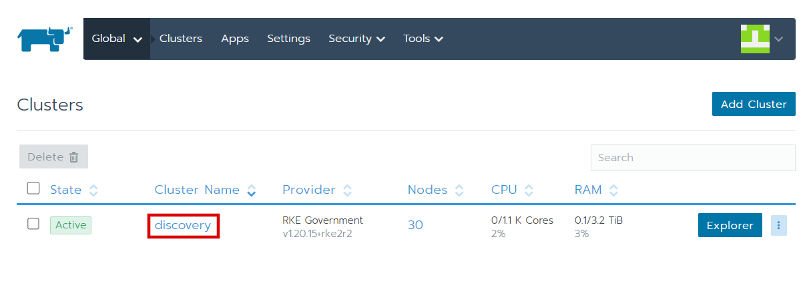

3. Click on 'Projects/Namespaces' to view a list of projects you have defined in
   discovery.

    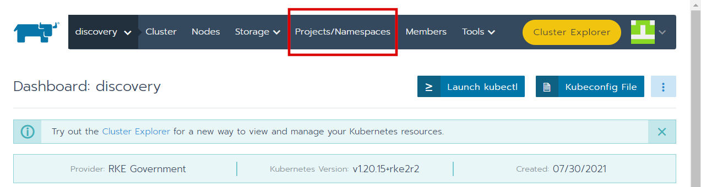

4. In the top-right corner of the list of projects and namespaces, click "Add
   Project".

    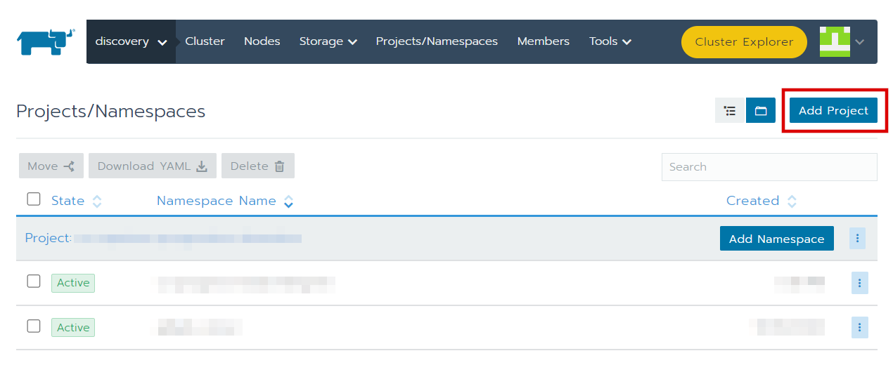

5. In the form that appears, fill in the Project Name, and add any members who
   should also have access to the project. Each member can be assigned their own
   permissions. Once you are satisfied with the information in this form, click
   the "Create" button to create the project.

    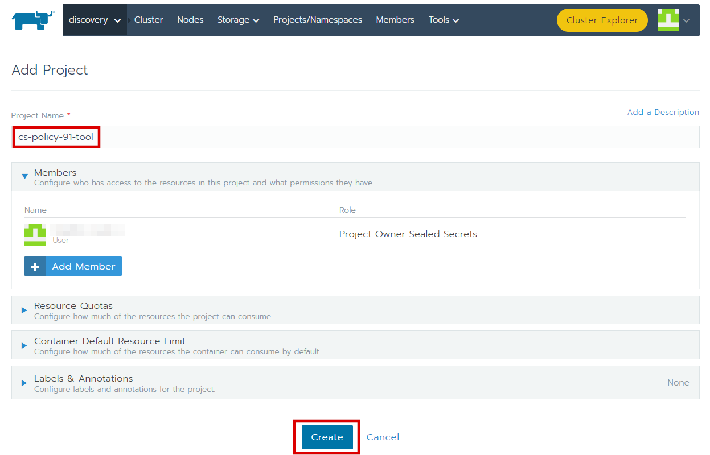

6. After creating the project, you will be sent back to the list of projects.
   You should see the project you just created in the list. Click its name in
   the list.

    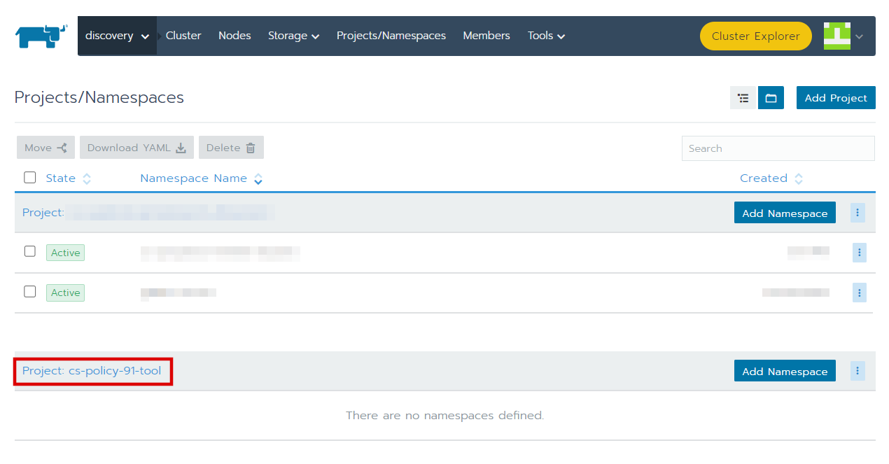

7. From the top bar, hover over "Resources" tab.

    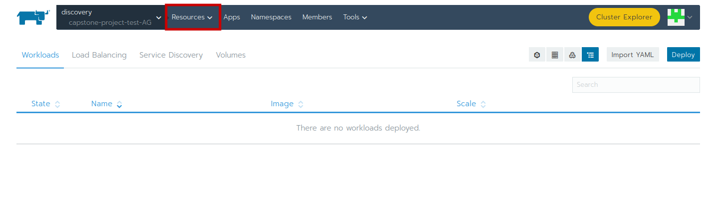

8. From the "Resources" dropdown menu, click on "Secrets".

    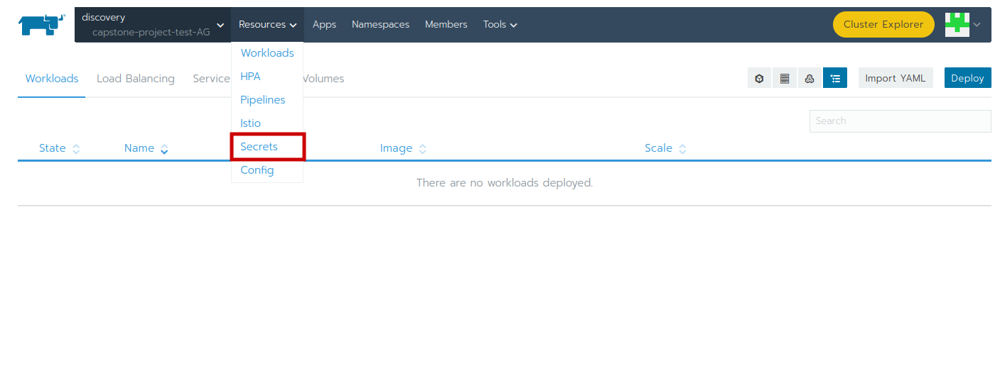

9. In the top-right corner of the secrets page, click "Add Secret".

    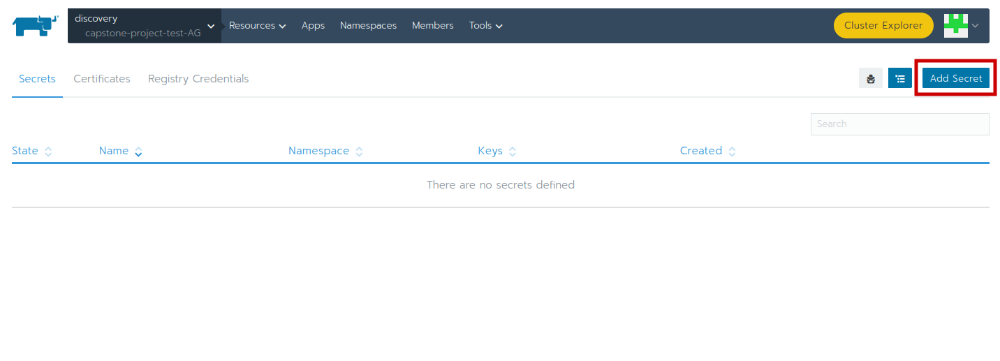

10. Copy the placeholder secrets values from the Table in [Secrets](#secrets) section. 

    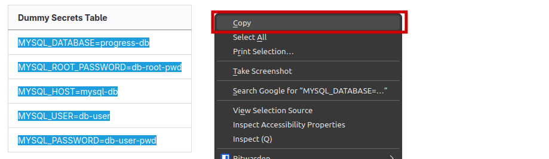

11. Give the secrets file a name that matches the name in the deployment YAML (**p91-mysql-secrets** by default) and paste the copied values into the first 'Key' field.
    
    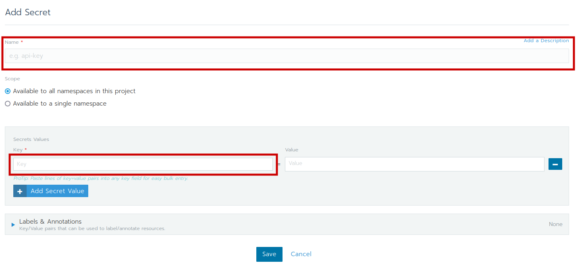

12. Change the values as suggested in the Secrets section. From bottom of page, click save.

    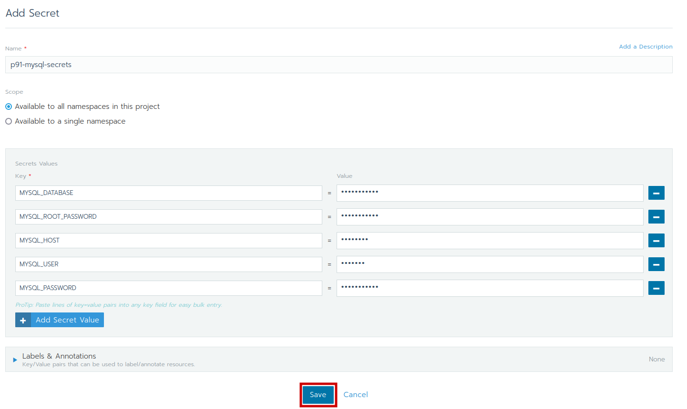

13. Now from the "Resources" tab in top bar, click on the "Workloads" dropdown option.

    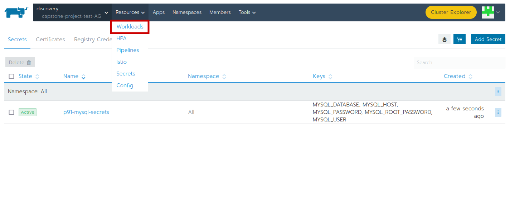

14. In the top-right corner of the project's page, click "Import YAML".

    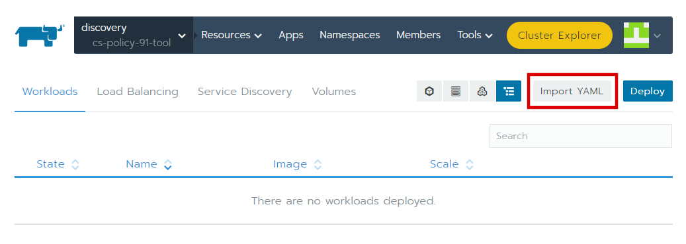

15. In the dialogue that appears:
    1. Click the "Read from a file" button and select the
        `mern-deployment-discovery.yaml` file in your file system, or
        alternatively, paste its contents into the provided code block.

        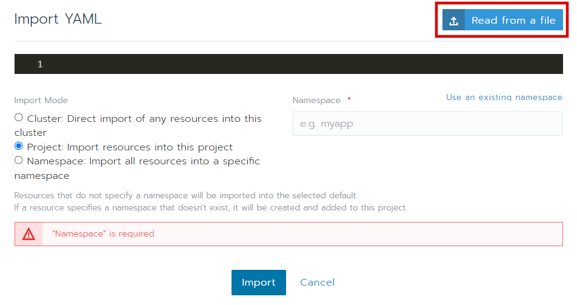

    2. Once the YAML has been uploaded, type a namespace name into the
       "Namespace" field. It does not need to match the project name.

        > If necessary, click the "Add to a new namespace" link above the
        > "Namespace" field so that you get a text input instead of a dropdown
        > list.

        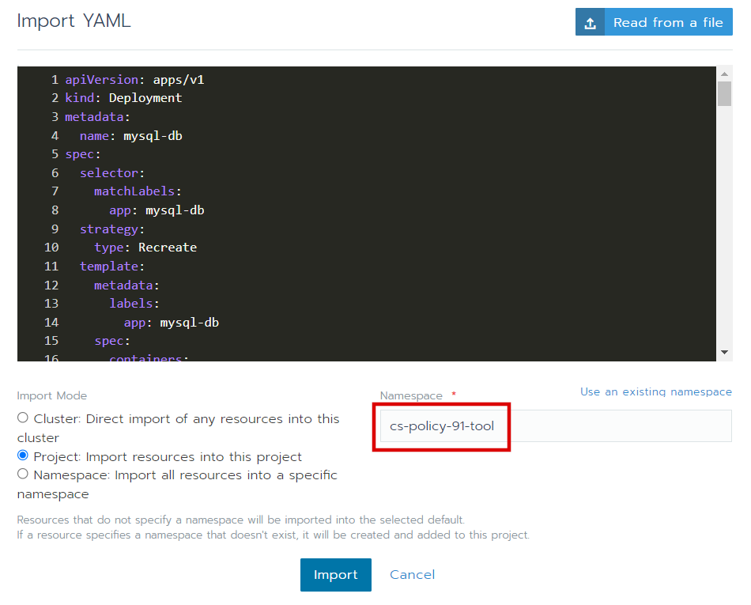

    3. Click the "Import" button at the bottom of the dialogue to create the
       cluster from the given deployment YAML.

        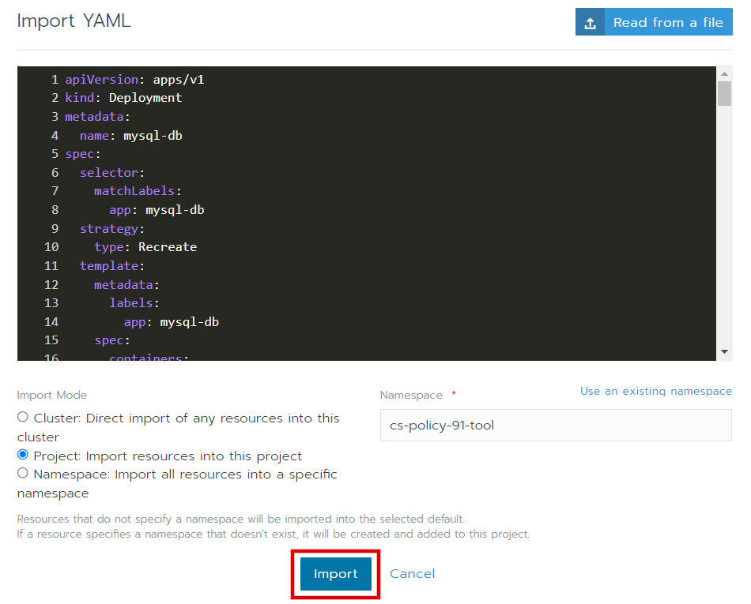

16. Once the YAML is uploaded, you should see that the mysql-db, node-backend,
   and react-frontend resources are present. Until the persistent volume is set
   up for mysql-db, it will not be able to start. We will create the volume in
   the next few steps.

    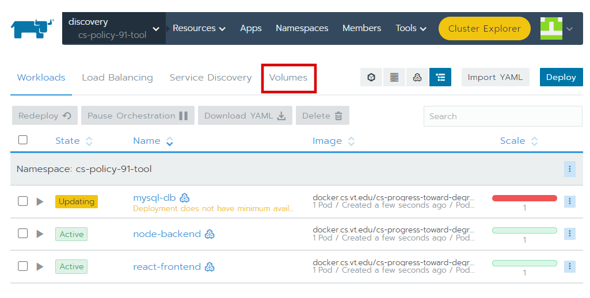

17. Click the "Volumes" tab, and in the top-right corner of the page, click the
   "Add Volume" button.

    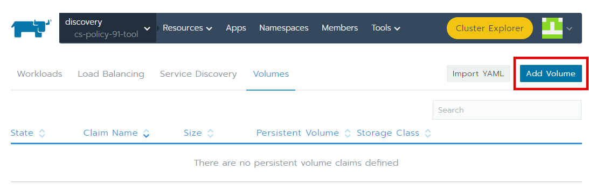

18. Fill in the volume name as "mysql-data" (must match the deployment YAML),
   specify the size of the requested storage, and click the "Create" button to
   create the persistent volume.

    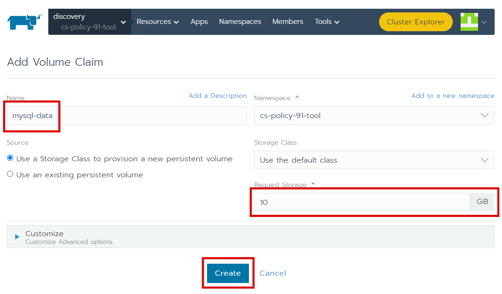

19. Click the "Workloads" tab. Click the three dots next to 'mysql-db', and in
   the menu that appears, click "Redeploy". This will allow 'mysql-db' to see
   the new volume that was created in the last step.

    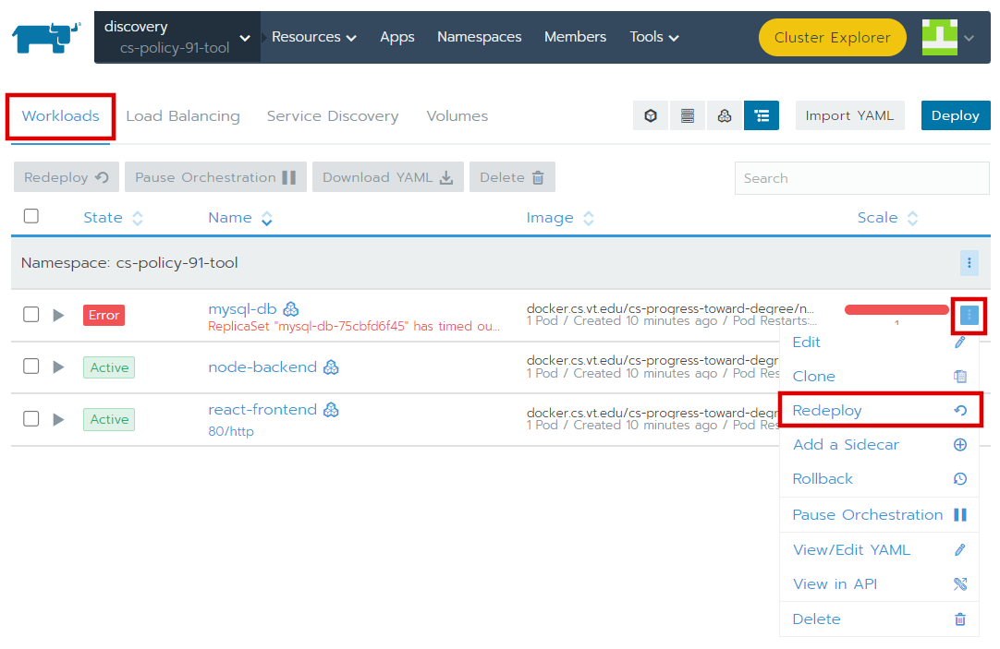

20. About 15-30 seconds after you redeploy 'mysql-db', all rows row should be in
   an "Active" state. At this point, the system is initializing and will be
   ready to use in a moment. You can monitor the initialization in the
   'mysql-db' and 'node-backend' logs. Once initialization is complete, you can
   quickly navigate to the site by clicking the "80/http" link in the
   'react-frontend' row.

    > **Note:** When the cluster is first started, no users will have access to
    > the site other than the user defined in the `INIT_ADMIN_PID` environment
    > variable of 'node-backend', as long as `INIT_ADMIN` was set to a non-zero
    > value. This user will have administrative privileges on the site, and can
    > add more users to the system in the website.

    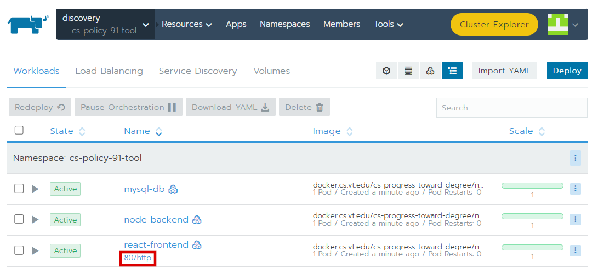
    
    > **Note:** After the initial admin is added to the system when the cluster
    > is first started, you are advised to set  the `INIT_ADMIN` environment
    > variable of 'node-backend' to "0" so that they will not be automatically
    > added back in if 'node-backend' needs to be redeployed. You can edit this
    > environment variable by clicking the three dots next to 'node-backend' and
    > clicking the "Edit" button. Then, under "Environment Variables", update
    > the variable as needed and click the "Save" button at the end of the page.

### Updating the images

If changes are made to the code, or you would like to push the images to your
own container registry, you can use the `build-images.sh` and `push-images.sh`
bash script provided in the `scripts/` directory.

To build the images from the source code and push them to a registry, run the
following set of commands:

```bash
./scripts/build-images.sh && ./scripts/push-images.sh <remote_url> <image_tag>
```

**Arguments to `push_images.sh`:**
1. `<remote_url>`: The container registry where the images will be stored. If
   not provided, defaults to
   "docker.cs.vt.edu/bbradner/cs-degree-progress".
   Please ensure that there is no trailing slash (`/`) at the end of the URL for
   the script to run properly.
2. `<image_tag>`: The image's tag as it will be pushed to the registry. If not
   provided, defaults to "latest".

> **Note:** You may be prompted to log into the remote container registry when
> running the `./scripts/push-images.sh` script. If you are not prompted, then
> you are likely logged in with your Docker instance already.

## Local Installation

### Prerequisites

- WSL 2 (Windows Subsystem for Linux) to run Linux commands in Windows
    - https://www.linuxfordevices.com/tutorials/linux/install-debian-on-windows-wsl
- Docker
    - Docker Desktop: https://www.docker.com/products/docker-desktop/
    - Ties into WSL 2 to enable use of `docker` commands
- Minikube
    - Choose your OS and install from: https://minikube.sigs.k8s.io/docs/start/

### Installation Recommendations

#### Minikube performance upgrade

Once Minikube has been installed, run the following to improve its performance

```bash
minikube config set cpus 4
minikube config set memory 4096

# If you previously ran `./scripts/bootstrap.sh`
minikube delete
```

#### `tmux`

Tmux is a good tool for splitting the terminal view when managing the Kubernetes
cluster, especially if you would like to view the pods in the cluster and logs
at the same time. Since many of the monitoring tools block the current shell, it
is useful to split the currrent terminal to see everything at once, and `tmux`
can faciliate this. To install `tmux` run:

```bash
sudo apt-get install tmux
```

Here's a [quick
guide](https://www.hamvocke.com/blog/a-quick-and-easy-guide-to-tmux/) to `tmux`
that may be helpful.

#### `stern`

Stern is a tool that allows you to tail the logs of an entire Kubernetes cluster
and filter the pods you see with a regular expression. You can install it at
https://github.com/stern/stern#installation (I recommend installing
[Homebrew](https://brew.sh/) (Macs should already have this) and running `brew
install stern`)

Then, to view the logs of the entire cluster, you can run:

```bash
stern -n cs-progress-toward-degree ".*"
```

## Quick start (local)

```bash
# Ensure minikube is running according to local setup requirements
./scripts/bootstrap.sh

# Build Docker images and load them into Minikube
# (May take a while to load the images. See recommendations section for a workaround)
./scripts/build-images.sh
./scripts/load-images.sh

# (Optional) Verify that minikube has the images
minikube image ls

# Start the cluster
./scripts/start-cluster.sh

# Expose ports to access locally (blocks the terminal)
minikube tunnel

# Apply local changes during development
./scripts/stop-cluster.sh && ./scripts/build-images.sh && ./scripts/load-images.sh && ./scripts/start-cluster.sh

# Apply local changes during development (using minikube's docker-env)
./scripts/stop-cluster.sh && ./scripts/build-images.sh && ./scripts/start-cluster.sh

# Watch the cluster (blocks the terminal)
./scripts/watch-cluster.sh

# Stop the cluster (just the pods)
./scripts/stop-cluster.sh

# (Optional) Stop the cluster (remove all resources)
./scripts/stop-cluster.sh -a

# (Optional) Delete locally-mounted volumes and downloaded npm libraries
./scripts/clean.sh

# (Optional) Stop minikube before shutdown
minikube stop
```

### Recommendations

#### Building images

Instead of running `./scripts/load-images.sh` to link the images every time you
build them (which can take forever), you can link your current terminal window's
Docker commands to minikube so that images you build from there will be built
directly in minikube's image store. To set this up in a terminal, run the
following command:

```bash
eval $(minikube -p minikube docker-env)
```

From there, any images you build in that terminal window (i.e. via
`./scripts/build-images.sh`) will appear in minikube and you can stop and start
the cluster to see the changes.
